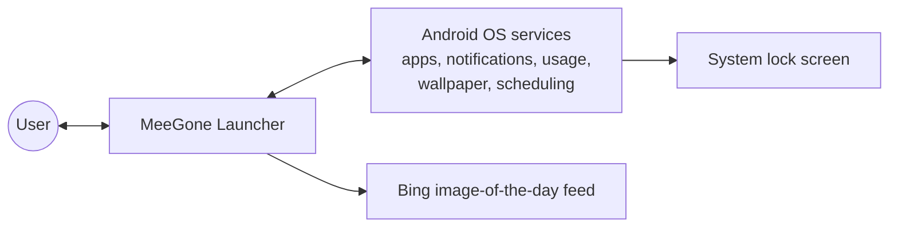
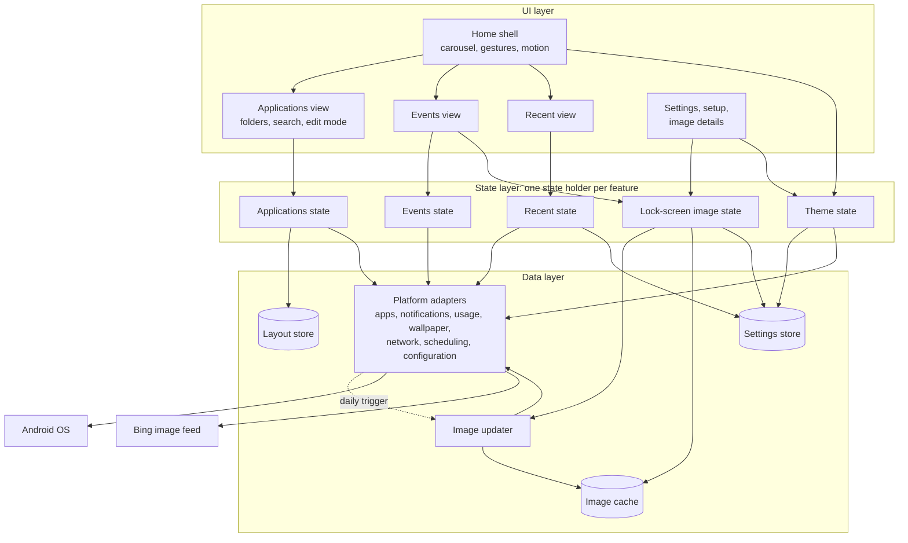
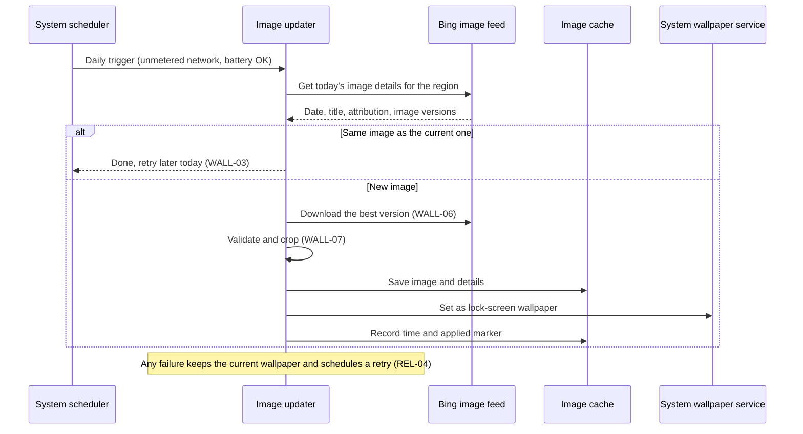

# MeeGone Launcher — Software Requirements Specification

**Version** 0.1 (draft for review) · **Date** 2026-11-15 · **Status** Draft

| Version | Date | Change |
|---|---|---|
| 0.1 | 2026-11-15 | First draft |

## Contents

1. [Introduction](#1-introduction)
2. [Overall description](#2-overall-description)
3. [Nokia N9 reference and adaptation](#3-nokia-n9-reference-and-adaptation)
4. [Functional requirements](#4-functional-requirements)
5. [User interface requirements](#5-user-interface-requirements)
6. [Non-functional requirements](#6-non-functional-requirements)
7. [Architecture](#7-architecture)
8. [External interfaces](#8-external-interfaces)
9. [Acceptance criteria](#9-acceptance-criteria)
10. [Out of scope and future considerations](#10-out-of-scope-and-future-considerations)
11. [Open questions](#11-open-questions)

[Appendix A. Traceability](#appendix-a-traceability)

---

## 1. Introduction

### 1.1 Purpose

This document specifies what MeeGone Launcher must do and how well it must do it. It is written for product, design, engineering and QA.

It is deliberately technology-neutral: it names no programming language, framework, library or tool. Those choices belong to the implementation team, within the constraints in section 7.

### 1.2 Scope

MeeGone Launcher ("MeeGone") is a home-screen app for Android phones and tablets. It brings the interaction model and look of the Nokia N9 (MeeGo 1.2 Harmattan, 2011) to current Android:

- three home views (**Events**, **Applications**, **Recent**) joined in a swipeable, wrap-around carousel;
- fluid, finger-following motion throughout;
- calm, solid home backgrounds, true black in the dark theme;
- a lock screen that shows a new **Bing image of the day** every day;
- **System** (default), **Light** and **Dark** themes;
- a deliberately small architecture.

| ID | Goal |
|---|---|
| G1 | **N9 feel.** An N9 owner recognises the model at once; a newcomer learns it within a minute. |
| G2 | **Fluid.** Every movement follows the finger and settles naturally. |
| G3 | **Simple.** Few concepts, few settings, few moving parts. |
| G4 | **Respectful.** Works offline; no accounts, no tracking, minimal permissions. |

Section 10 lists what v1 does not do (replace the lock screen, control other apps' windows, widgets, feeds and more) and why.

### 1.3 Definitions

| Term | Meaning |
|---|---|
| Launcher, home app | The app Android shows when the user presses Home. |
| Home view | One of the three full-screen views: Events, Applications, Recent. |
| Carousel | The horizontal, wrap-around arrangement of the home views. |
| Edit mode | Applications-view state for moving, grouping and uninstalling apps. |
| Close mode | Recent-view state that shows remove controls on every card. |
| Image of the day | The photograph Bing publishes each day, with its title and attribution. |
| Lock-screen wallpaper | The image the system lock screen shows behind its clock and unlock controls. |
| Notification access, usage access | Special access the user grants in system settings that lets an app read active notifications or app-usage history. |
| Profile | A user profile on the device, e.g. personal or work. |
| App accent | A colour derived from an app's icon and reused wherever that app appears. |
| Reference device | A mid-range phone released no more than 4 years before v1, with 4 GB RAM and a 60–120 Hz display. All performance targets apply to it. |

### 1.4 References

| ID | Reference |
|---|---|
| R1 | MeeGo Harmattan UX guidelines (archive): [Home](https://n9.dy.fi/meego/UX/pages/Home.html) |
| R2 | MeeGo Harmattan UX guidelines (archive): [Overall UI model](https://n9.dy.fi/meego/UX/pages/Overall_UI_Model.html) |
| R3 | MeeGo Harmattan UX guidelines (archive): [Guiding principles](https://n9.dy.fi/meego/UX/pages/Guiding_Principles.html) |
| R4 | Nokia N9 user guide: [Touch screen actions](https://nokia-n9-16gb.helpdoc.net/en/nokia-n9-user-guide/basic-use/touch-screen/touch-screen-actions) |
| R5 | GSMArena: [Nokia N9 review, user interface](https://m.gsmarena.com/nokia_n9-review-659p4.php) |
| R6 | WAPReview: [Nokia N9 Swipe UI tips and tricks](https://wapreview.com/15554/) |
| R7 | ISO/IEC/IEEE 29148:2018, *Systems and software engineering — Requirements engineering* |
| R8 | W3C, *Web Content Accessibility Guidelines (WCAG) 2.2*; contrast and target-size criteria applied to native UI |

### 1.5 Conventions

- Every requirement has an ID (`AREA-NN`), a statement and a priority: **Must** (needed for v1), **Should** (planned for v1, may slip) or **Could** (only if time allows). Won't-have items are in section 10.
- "N9:" notes name the reference behaviour behind a requirement.
- Left and right refer to left-to-right languages; right-to-left layouts mirror them (L10N-02).
- Durations are targets at normal system animation speed. Motion values are starting points for design tuning.

---

## 2. Overall description

### 2.1 Product perspective

MeeGone is a self-contained app with no server and no account. It talks to only two things:

- **the operating system**, to list and launch apps, read notifications and usage history (when the user allows it), set the lock-screen wallpaper and schedule one daily task;
- **the Bing image-of-the-day feed**, its only network service.



### 2.2 Design principles (from the N9)

| ID | Principle | What it means for MeeGone |
|---|---|---|
| P1 | One gesture, three views | Everything at home is one horizontal drag away. No pages, dock or app drawer. |
| P2 | Direct manipulation | Content follows the finger and settles with natural physics. Any animation can be interrupted. |
| P3 | Calm surfaces | Home views have solid backgrounds (true black in Dark). Photography belongs to the lock screen. |
| P4 | Colour as wayfinding | An app's accent colour carries from its icon into its notifications and its Recent card. |
| P5 | Content over chrome | No toolbars on home views. Controls appear only when needed (edit mode, close mode). |
| P6 | Small and honest | Few settings. Never pretend to do something the platform doesn't allow, such as "closing" other apps. |

### 2.3 Product functions

| ID | Function |
|---|---|
| F1 | Home carousel: Events, Applications and Recent, wrapping around. |
| F2 | Applications: four-column vertical grid, user-arranged, with folders, edit mode, uninstall and search. |
| F3 | Events: date header, live notifications grouped by app, and an image-of-the-day card. |
| F4 | Recent: recently used apps as colour cards, 3×3 or 2×2 by pinch, with close mode. |
| F5 | Daily lock-screen image from Bing. |
| F6 | Themes: System (default), Light, Dark. |
| F7 | A motion system covering all of the above. |
| F8 | Settings and first-run setup. |

### 2.4 User classes

| Class | Description | Main needs |
|---|---|---|
| Everyday user | Any Android user who wants a calmer home screen | Fast access to apps, little setup |
| N9 enthusiast | Remembers MeeGo Harmattan | Faithful structure, motion and look |
| Users with accessibility needs | Screen reader, switch access, large text, reduced motion | Every function available without gestures or animation |

### 2.5 Operating environment

- Android 10 (API level 29) or later. This version is the first with a system-wide dark theme, fully gestural navigation and a standard system request for becoming the home app, so making it the minimum avoids compatibility branches (A1).
- Phones (primary), foldables and tablets.
- Every system navigation mode: gestures, two buttons, three buttons.
- Personal and work profiles.

### 2.6 Constraints

These are facts of the platform and the market, not design choices.

| ID | Constraint | Consequence |
|---|---|---|
| C1 | A third-party app can't replace or draw over the secure system lock screen. | MeeGone sets only the lock-screen *wallpaper*. The lock screen's clock, unlocking and notifications stay the system's. |
| C2 | A launcher can't catch edge swipes inside other apps. | Leaving an app uses the system Home gesture or button. The N9's "swipe in from an edge to leave, swipe down from the top to close" can't be reproduced. |
| C3 | A third-party launcher can't see other apps' window thumbnails, can't tell which apps are running and can't stop them. | The N9 "Open applications" view becomes **Recent**: recently used apps (from usage access) shown as colour cards. Removing a card only hides it. |
| C4 | Reading notifications or usage history needs special access the user grants in system settings. | Events and Recent explain what they need and ask for it. Both work in a reduced state without it. |
| C5 | Device makers can customise or override the lock screen. | On some devices the image may not appear. MeeGone detects what it can and tells the user. |
| C6 | Nokia, N9, MeeGo, Harmattan, Bing and Microsoft are third-party marks. Nokia's fonts, icons, sounds and wallpapers are proprietary. | All assets are original and no affiliation is implied (LEGAL-01 to LEGAL-06). |
| C7 | This document prescribes no technology stack. | Implementation choices must satisfy section 7. |

### 2.7 Assumptions and dependencies

| ID | Assumption or dependency |
|---|---|
| A1 | Android 10 and later covers the target audience. |
| A2 | The Bing image-of-the-day feed stays publicly reachable. It is undocumented, has no service-level agreement and may change without notice. |
| A3 | The image source's terms permit downloading the daily image and using it as a device wallpaper with attribution. To be confirmed (Q2). |
| A4 | Most devices honour a lock-screen wallpaper set by an app. |
| A5 | Users can grant notification and usage access. Enterprise device policy may prevent it. |

---

## 3. Nokia N9 reference and adaptation

The N9's "Swipe" interface (R1–R6) is the reference for structure, behaviour and feel. Where Android makes a behaviour impossible for a third-party launcher, MeeGone keeps the intent and says what changed.

| N9 behaviour | MeeGone adaptation | Requirements |
|---|---|---|
| Three home views (Events, Applications, Open applications) sit side by side. Dragging horizontally moves between them, and the row wraps around like a carousel. | Same three views and wrap-around. "Open applications" becomes "Recent" (C3). | HOME-02 to HOME-04 |
| Applications: every installed app in one four-column grid that scrolls vertically. No pages, no dock. New apps go at the end. | Same. | APPS-01 to APPS-06 |
| Long-press an app to drag it; the other icons rearrange around it. A red cross uninstalls. | Long-press opens a menu or picks the icon up. Edit mode shows remove badges. | APPS-11 to APPS-13 |
| Events: notifications at the top stay until opened or deleted. A bar shows the date and weather. Feeds follow below. | Date and alarm header, live notifications grouped by app, and an image-of-the-day card where the feeds were. No weather or social feeds. | EVT-01 to EVT-14 |
| Open applications: thumbnails of recently used apps, newest top-left, 3×3 or 2×2 by pinch. Long-press shows a ✕ on each and "Close all". | Recent: colour cards for recently used apps with the same order, pinch and long-press behaviour. ✕ removes a card from the list and doesn't stop the app. | REC-01 to REC-11 |
| Swipe in from the left, right or bottom edge to leave an app, which keeps running. Swipe down from the top to close it. | The system Home gesture or button returns to MeeGone (C2). | HOME-06 |
| Leaving an app returns to the home view it was opened from. | Home returns to the view that was showing when the user left. | HOME-06 |
| The wallpaper appears only on the lock screen; home views are black. Double-tap wakes the phone, and a swipe from any edge unlocks it. | The Bing image of the day becomes the system lock-screen wallpaper. Home views are solid (true black in Dark). Waking and unlocking stay the system's (C1). | WALL-01 to WALL-17, THEME-04 |
| An app's colour repeats in its icon, its events, its thumbnail and the app itself. | The app accent colour appears in Events and Recent. | APPS-17, EVT-09, REC-04 |
| A status bar shows on every screen; tapping it opens a status menu. | The system status bar stays visible and adapts to the theme. The system's quick settings replace the status menu. | THEME-05 |
| Portrait home on a 3.9-inch AMOLED screen. | Portrait on phones, any orientation on large screens, true-black Dark theme. | HOME-12, THEME-04 |

Additions the N9 didn't have: app search, app shortcuts in the long-press menu, a light theme, a view indicator while swiping, and work-profile support.

---

## 4. Functional requirements

### 4.1 Home shell and navigation (HOME)

| ID | Requirement | Priority |
|---|---|---|
| HOME-01 | MeeGone shall register as a home app and, once chosen as the default, appear on every Home action. | Must |
| HOME-02 | The home shall consist of three full-screen views, left to right: Events, Applications, Recent. | Must |
| HOME-03 | A horizontal drag that starts anywhere in a view, except on an element that uses horizontal drags itself, shall move between views with the content following the finger. | Must |
| HOME-04 | Navigation shall wrap around: moving right past Recent shows Events, and moving left past Events shows Recent. A setting shall let the user turn wrap-around off. | Must (setting: Could) |
| HOME-05 | Applications shall be the view shown after first-run setup and after the device restarts. | Must |
| HOME-06 | When the user comes home from an app, MeeGone shall show the view that was on screen when the user last left the home. A setting shall offer "Always open Applications" instead. N9: leaving an app returns to the view it was opened from. | Must |
| HOME-07 | A Home action while the home is already showing shall first close any open folder, menu, search, edit mode or close mode. If none is open, it moves to Applications; if Applications is already showing, it scrolls to the top. | Must |
| HOME-08 | Back on the home shall close the topmost open element (folder, menu, search, edit mode, close mode) and otherwise do nothing. | Must |
| HOME-09 | A three-segment view indicator shall appear while views are dragged and fade out after they settle. | Should |
| HOME-10 | Long-press on empty space in Events or Applications shall open the home menu: Launcher settings, Lock-screen image, and (in Applications) Edit applications. In Recent, long-press enters close mode instead (REC-07). N9: long-press on Events opened its settings. | Must |
| HOME-11 | Home views shall use the theme's solid background (no wallpaper), draw edge to edge behind the system bars, and keep content clear of system bars, cut-outs and rounded corners. | Must |
| HOME-12 | On phones the home shall stay in portrait. On large screens (smallest width 600 dp or more) it shall support every orientation and window size and adapt its layout. | Must |
| HOME-13 | Switching views shall never depend on swiping in from a screen edge, so it doesn't compete with the system Back gesture. | Must |
| HOME-14 | Applications shall always leave at least one row of empty space below its last row, so the home menu (HOME-10) can always be reached. | Must |

### 4.2 Applications view (APPS, FOLD, SRCH)

#### 4.2.1 Grid and editing

| ID | Requirement | Priority |
|---|---|---|
| APPS-01 | Applications shall show every launchable app from every available profile, each as an icon with a single-line label. | Must |
| APPS-02 | Apps shall form one vertically scrolling grid with four columns on phones. On screens 600 dp wide or more, columns are added so each cell stays between 96 and 128 dp wide. | Must |
| APPS-03 | Applications shall have no pages, no dock and no widgets. | Must |
| APPS-04 | At first-run setup, apps shall be ordered alphabetically by label. | Must |
| APPS-05 | At first-run setup, the default phone, messaging, browser and camera apps shall come first, where the system identifies them. | Could |
| APPS-06 | Newly installed apps shall be added at the end of the grid. N9: new apps appear at the bottom. | Must |
| APPS-07 | A newly installed app shall carry a small dot until it is first opened. | Could |
| APPS-08 | An uninstalled app shall disappear at once (with animation) and be removed from any folder. An updated app shall get its new label and icon without moving. | Must |
| APPS-09 | Unavailable apps (paused work profile, suspended, or on missing storage) shall be shown dimmed. Tapping one shall defer to the system's explanation, or show a short message if the system gives none. | Must |
| APPS-10 | Tapping an icon shall launch the app with a transition that grows from the icon (ANIM-08). | Must |
| APPS-11 | Long-press on an icon shall open a menu with App info, Uninstall (when allowed), Edit applications and, while MeeGone is the default home app, the app's shortcuts. Dragging after the long-press shall pick the icon up and enter edit mode. | Must (shortcuts: Should) |
| APPS-12 | Edit mode shall show a remove badge (✕) on every app the user can uninstall, let the user drag icons while the others move aside, scroll automatically when an icon is dragged near the top or bottom, and end with a Done button, Home or Back. N9: a red cross uninstalls. | Must |
| APPS-13 | Tapping ✕ shall open the system's uninstall confirmation; MeeGone never uninstalls anything itself. Apps that can't be uninstalled show no ✕. | Must |
| APPS-14 | Edit mode shall offer "Sort A–Z", which asks for confirmation and can be undone for 5 seconds. | Could |
| APPS-15 | All icons shall share one rounded-square shape. Layered icons are masked to it; older single-image icons are scaled onto a neutral plate of the same shape. | Must |
| APPS-16 | Labels shall be single-line and ellipsised, use the theme text colour and scale with the system font size. Cells grow taller rather than overlap. | Must |
| APPS-17 | Each app's accent colour shall be derived once from its icon, adjusted for contrast in each theme (THEME-07), and reused in Events and Recent. | Must |
| APPS-18 | The layout (order and folders) shall persist across restarts and app updates. At every start MeeGone reconciles it with the installed apps: apps that are gone are removed and new apps are added at the end. | Must |
| APPS-19 | Users shall be able to hide an app from the long-press menu and unhide it in Settings. Hidden apps are also left out of search and Recent. | Could |
| APPS-20 | Work-profile apps shall appear in the same grid with the system's work badge. | Should |
| APPS-21 | Layout and settings shall take part in the system's standard app backup and restore. After a restore, apps that aren't installed are skipped. | Should |

#### 4.2.2 Folders

| ID | Requirement | Priority |
|---|---|---|
| FOLD-01 | Dropping an icon onto another and holding it there for about 400 ms shall create a folder containing both. | Must |
| FOLD-02 | A folder icon shall show up to four of its apps as a 2×2 preview inside the standard icon shape, with the folder name as its label. | Must |
| FOLD-03 | A new folder shall be named "Folder" (translated). Tapping the name in an open folder lets the user rename it. | Must |
| FOLD-04 | Tapping a folder shall open it as a panel that grows from the folder icon over a dimmed view, showing its apps in a four-column grid that scrolls if needed. Back, Home or a tap outside closes it. | Must |
| FOLD-05 | Apps shall be draggable within a folder, out of it and into it. Folders can't contain folders. | Must |
| FOLD-06 | A folder left with one app shall turn back into that app; an empty folder is deleted. | Must |
| FOLD-07 | A new folder shall be named after its apps' shared category (e.g. "Games") when they have one. | Could |

#### 4.2.3 Search

| ID | Requirement | Priority |
|---|---|---|
| SRCH-01 | Pulling down on Applications while it is scrolled to the top shall reveal a search field and open the keyboard. | Should |
| SRCH-02 | Results shall update with each keystroke, matching app labels regardless of case and accents. Matches at the start of a word rank above matches inside a word; ties are sorted alphabetically. | Should |
| SRCH-03 | The keyboard's action key shall launch the first result. | Should |
| SRCH-04 | Closing search (Back, Home, or scrolling down past the field) shall restore the grid and its scroll position. | Should |
| SRCH-05 | When nothing matches, search shall offer "Search the web for '…'" using the device's default search handler. | Could |

### 4.3 Events view (EVT)

| ID | Requirement | Priority |
|---|---|---|
| EVT-01 | A header shall show the weekday and date in large, light type. N9: Events had a date and weather bar at the top. | Must |
| EVT-02 | When an alarm is set, the header shall show the next alarm time; tapping it opens the app that set the alarm. | Should |
| EVT-03 | Without notification access, a card shall explain what Events shows and offer a button to the system's notification-access screen. The header and image card still work. | Must |
| EVT-04 | With access, active notifications shall be listed below the header, grouped by app, most recent group first. Each group shows the app icon, accent colour, app name, count, and the latest notification's title and text (at most two lines). | Must |
| EVT-05 | Ongoing notifications (media playback, navigation, running services) and MeeGone's own shall be left out. | Must |
| EVT-06 | Tapping a notification, or a group holding one, shall open the notification's content; if the notification is meant to disappear when opened, MeeGone removes it. Tapping a group of several expands it. | Must |
| EVT-07 | A "Notifications" section header shall carry a Clear button that removes all clearable notifications. N9: notifications stay until opened or deleted. | Must |
| EVT-08 | Long-press on a notification or group shall offer Dismiss and the app's notification settings. | Must |
| EVT-09 | Group rows shall show the app accent colour (APPS-17) as a thin marker. N9: colour coordination. | Should |
| EVT-10 | The list shall update live as notifications arrive and go away. | Must |
| EVT-11 | With no notifications to show, the view shall display a calm empty state ("No new events"). | Must |
| EVT-12 | While the daily lock-screen image is on, an "Image of the day" card below the notifications shall show a thumbnail, the title and the attribution. Tapping it opens the image details screen (WALL-15). A setting can hide the card. | Should |
| EVT-13 | Notification content shall stay on the device and in memory only. It is never stored, logged or transmitted. | Must |
| EVT-14 | Expanded groups shall show up to two of each notification's action buttons. | Could |

Swipe-to-dismiss is deliberately not used in Events or Recent, because horizontal drags belong to the carousel.

### 4.4 Recent view (REC)

| ID | Requirement | Priority |
|---|---|---|
| REC-01 | The view shall be titled "Recent" and shall never claim that apps are running or have been closed, since the platform doesn't reveal either (C3). | Must |
| REC-02 | Without usage access, a card shall explain what Recent shows and offer a button to the system's usage-access screen. No placeholder data is shown. | Must |
| REC-03 | With access, Recent shall show up to 18 launchable apps used in the last 24 hours, most recent first, filling rows left to right and top to bottom (newest top-left). MeeGone itself and hidden apps are left out. N9: newest at top-left, reordered on every switch. | Must |
| REC-04 | Each card shall be a rounded rectangle with roughly the screen's proportions, filled with the app's accent colour, with the app icon large and centred, the label below and the time since last use. | Must (time: Should) |
| REC-05 | The grid shall have three columns by default (3×3 per screen on a typical phone). Pinching in switches to two columns (2×2) and pinching out switches back. The choice persists. On large screens both layouts add columns so cards keep a similar size. N9: 3×3 and 2×2 by pinch. | Must |
| REC-06 | Tapping a card shall bring that app to the front, resuming it if the system kept it, with a transition that grows from the card. | Must |
| REC-07 | Long-press anywhere on the grid shall enter close mode: a ✕ on every card and a "Clear all" button. Tapping empty space, Back or Home leaves close mode. N9: long-press showed ✕ and "Close all". | Must |
| REC-08 | ✕ and Clear all shall remove cards from Recent only. A removed app comes back when it is next used. The confirmation reads "Removed from Recent". | Must |
| REC-09 | The list shall refresh when the view becomes visible and when MeeGone returns to the foreground. It shall not poll while the screen is off. | Must |
| REC-10 | With no recent apps, the view shall show an empty state ("No recent apps"). | Must |
| REC-11 | Settings shall offer a 12-hour, 24-hour or 3-day window for Recent. | Could |

### 4.5 Daily lock-screen image (WALL)

| ID | Requirement | Priority |
|---|---|---|
| WALL-01 | While "Daily lock-screen image" is on, MeeGone shall download Bing's image of the day and set it as the device's lock-screen wallpaper only. The home wallpaper and the home views are untouched. | Must |
| WALL-02 | MeeGone shall not change the lock-screen wallpaper until the user has confirmed the feature, in setup or in Settings. In setup the switch starts on, but nothing is applied before the user taps Continue. | Must |
| WALL-03 | MeeGone shall check for a new image once a day after local midnight. If the feed still returns the previous image, it retries up to three more times that day, at least two hours apart. | Must |
| WALL-04 | Automatic downloads shall run only on unmetered networks unless "Use mobile data" is on (default off), and shall wait while battery saver is on or the battery is low. | Must |
| WALL-05 | The feed region shall default to "Automatic", derived from the device's language and region and falling back to United States English. The user can choose any other region the feed supports. | Must |
| WALL-06 | MeeGone shall pick a portrait version of the image when the feed offers one at least as large as the screen, and otherwise the largest version, then centre-crop it to the lock screen's proportions. Downloads larger than 20 MB are rejected. | Must |
| WALL-07 | MeeGone shall accept images only over HTTPS, and only content that decodes as an image at least 720 px on its short side. Anything else is discarded. | Must |
| WALL-08 | The wallpaper shall be set only after download, validation and cropping have all succeeded. On any failure the current lock-screen wallpaper stays as it is. | Must |
| WALL-09 | MeeGone shall keep the current and the previous image with their details (date, region, title, attribution, info link) and delete older ones. | Must |
| WALL-10 | If no image has ever been downloaded, the lock screen shall be left as it is. No placeholder image is applied. | Must |
| WALL-11 | "Update now" shall fetch the image at once over any available connection. | Must |
| WALL-12 | Turning the feature off shall stop all downloads and delete the cached images. The current lock-screen wallpaper stays; Settings offers "Reset lock screen to home wallpaper" and a shortcut to the system wallpaper settings. | Must |
| WALL-13 | If the device reports that wallpapers can't be set (device policy or no support), the feature shall appear as unavailable, with the reason. | Must |
| WALL-14 | Where the platform makes it detectable, if someone else changes the lock-screen wallpaper after MeeGone set it, MeeGone shall pause daily updates and ask whether to resume. | Should |
| WALL-15 | An image details screen shall show the image, title, attribution, date and region, with More info (opens the source's info link in the browser, when there is one), Update now and Settings. | Must |
| WALL-16 | Settings shall show when the image last updated and, in plain language, the last problem (e.g. "No connection. Will try again later."). | Should |
| WALL-17 | The user shall be able to browse the feed's images from the past seven days and pin one, which pauses daily updates until unpinned. | Could |

### 4.6 Theme (THEME)

| ID | Requirement | Priority |
|---|---|---|
| THEME-01 | Settings shall offer three themes: System (default), Light and Dark. | Must |
| THEME-02 | System shall follow the device's dark-theme setting, including scheduled changes, while MeeGone is running. | Must |
| THEME-03 | The theme shall apply to every MeeGone surface: home views, folders, menus, dialogs, search, settings and setup. | Must |
| THEME-04 | Dark shall use a true-black background on home views (as on the N9; it also saves power on OLED screens). Light shall use a near-white background. Colour values are in section 5.3. | Must |
| THEME-05 | System bar icons shall switch between light and dark to stay legible on the current background. | Must |
| THEME-06 | A theme change shall cross-fade (ANIM-19) without a restart and keep the current view, scroll position, open folder and any edit or close mode. | Must |
| THEME-07 | App accent colours shall be adjusted per theme to keep at least 3:1 contrast against the background. | Must |

### 4.7 Motion and feedback (ANIM)

#### 4.7.1 Rules

| ID | Requirement | Priority |
|---|---|---|
| ANIM-01 | Movement driven by a gesture (dragging views or icons, pinching, pulling down for search) shall track the finger with no visible lag: at most one frame behind. | Must |
| ANIM-02 | When a gesture ends, motion shall continue at the finger's speed and settle with spring-like physics: lightly damped, overshooting by no more than 3 %. Gesture endings never use linear easing. | Must |
| ANIM-03 | Every animation shall be interruptible: touching a moving element catches it where it is, and no animation blocks input. | Must |
| ANIM-04 | Animations shall run at the display's refresh rate, within the jank budget in PERF-03. | Must |
| ANIM-05 | Durations shall scale with the system animation speed. When the system removes animations, transitions shall become instant or short fades (100 ms or less) and no function is lost. | Must |
| ANIM-06 | Transitions not driven by a gesture shall last 150–350 ms, and nothing decorative exceeds 400 ms. MeeGone's own animation never delays an app launch (PERF-06). | Must |

#### 4.7.2 Motion catalogue

| ID | Moment | Motion | Timing | Priority |
|---|---|---|---|---|
| ANIM-07 | View swipe released | Settle on the next view if dragged past 35 % of the width or flung; otherwise return. Wrapping around is seamless. | Spring, about 250–350 ms | Must |
| ANIM-08 | App launch | The app window grows from the tapped icon or card, using the platform's launch-from-bounds transition. | About 300 ms | Must |
| ANIM-09 | Return home | Home content scales from 94 % to 100 % and fades in. Skipped when the system already animates the return, so the two don't double up. | 250 ms, decelerating | Must |
| ANIM-10 | Icon press | The icon shrinks to 92 % on touch and springs back on release. | About 90 ms in | Must |
| ANIM-11 | View indicator | Fades in when a drag starts and fades out 600 ms after the views settle. | 100 ms in, 200 ms out | Should |
| ANIM-12 | Entering edit or close mode | Icons or cards shrink to 92 % and the ✕ badges pop in with a short stagger (120 ms in total at most). Reversed on exit. | 150 ms | Must |
| ANIM-13 | Drag and reorder | The picked icon lifts (110 %, soft shadow); neighbours slide to their new cells; the dropped icon settles into its cell. | Spring, about 220 ms | Must |
| ANIM-14 | Folder created | The target icon pulses while an icon hovers over it. On drop, both icons shrink into the folder preview. | 250 ms | Must |
| ANIM-15 | Folder opened or closed | The panel grows from the folder icon over a dimmed background and shrinks back into it on close. | 250 ms | Must |
| ANIM-16 | Pull down for search | The field appears in proportion to the pull. Past the threshold it snaps open and the keyboard rises. | Spring | Should |
| ANIM-17 | Recent pinch | Cards scale with the fingers. On release they reflow to two or three columns. | About 300 ms | Must |
| ANIM-18 | Card removed, Clear all | The card shrinks and fades and the others close the gap. Clear all collapses the cards in a quick stagger. | 180 ms and 220 ms; Clear all 400 ms at most | Must |
| ANIM-19 | Theme change | The whole screen cross-fades. | 250 ms | Must |
| ANIM-20 | Notifications change | New groups slide in at the top; dismissed ones collapse. | 200 ms | Must |
| ANIM-21 | App installed or removed | A new icon scales and fades in at the end of the grid. A removed icon shrinks away and the grid closes up. | 200 ms | Must |
| ANIM-22 | New image of the day | The card thumbnail cross-fades to the new image. | 300 ms | Should |
| ANIM-23 | Over-scroll | Lists stretch elastically at their ends, consistent with the platform. | Platform default | Must |
| ANIM-24 | Haptics | A light tick on long-press, on entering edit or close mode, and when a folder is created. Follows the system haptics setting. | Instant | Should |

### 4.8 Settings (SET)

| ID | Requirement | Priority |
|---|---|---|
| SET-01 | Launcher settings shall be reachable from the home menu (HOME-10) and from the system's home-app settings entry where the platform provides one. | Must |
| SET-02 | Settings shall contain only these groups. **Appearance:** Theme. **Home:** Home button opens (last view, or always Applications), Wrap-around. **Applications:** Hidden apps. **Recent:** Time window. **Lock-screen image:** Daily image, Region, Use mobile data, Show card in Events, Update now, Reset lock screen to home wallpaper, last-update status. **Access:** default home app, notification access, usage access (status and a shortcut for each). **About.** Items for Should and Could features appear only when those features ship. | Must |
| SET-03 | Changes shall take effect immediately. There is no Save button. | Must |
| SET-04 | v1 shall have no more than 12 user-adjustable options (simplicity budget, section 7.1). | Must |
| SET-05 | About shall show the version, open-source licences, the privacy notice and the non-affiliation statement (LEGAL-05). | Must |
| SET-06 | "Reset launcher" shall restore the default layout and settings after confirmation. | Should |

### 4.9 First-run setup (ONB)

| ID | Requirement | Priority |
|---|---|---|
| ONB-01 | The first launch shall run a setup of at most four screens: (1) Welcome; (2) make MeeGone the default home app, using the system dialog; (3) Daily lock-screen image, with a preview of today's image when online, the switch (on), Region (Automatic) and Continue; (4) optional access, Notifications for Events and Usage for Recent, each with Allow and Not now. | Must |
| ONB-02 | Each access request shall be preceded by one plain sentence saying what is read and why. Declining never blocks launching apps. | Must |
| ONB-03 | A user who accepts every default shall finish setup in under 60 seconds. | Must |
| ONB-04 | If MeeGone is open but isn't the default home app, a dismissible banner shall offer to make it the default, at most once a day. | Must |
| ONB-05 | Setup shall not ask about the theme. System applies by default and can be changed in Settings. | Must |

---

## 5. User interface requirements

### 5.1 Layout overview

```text
<---- drag left or right anywhere; the views wrap around (carousel) ---->

+---------------------+  +---------------------+  +---------------------+
| EVENTS              |  | APPLICATIONS        |  | RECENT              |
|                     |  |                     |  |                     |
| Sunday              |  | []   []   []   []   |  |  +---+ +---+ +---+  |
| 15 November         |  | Call Msg  Web  Cam  |  |  |   | |   | |   |  |
| Alarm 07:00         |  |                     |  |  |[] | |[] | |[] |  |
|                     |  | []   []   []   []   |  |  |   | |   | |   |  |
| NOTIFICATIONS Clear |  | Maps Pics Mail Mus  |  |  +---+ +---+ +---+  |
| [] Messages       3 |  |                     |  |  Mail  Maps  Music  |
|    Anna: See you... |  | []   []   []   []   |  |                     |
| [] Mail           1 |  | Cal  Clk  Note Set  |  |  +---+ +---+ +---+  |
|    Invoice #2231    |  |                     |  |  |   | |   | |   |  |
|                     |  | []   []   []   []   |  |  |[] | |[] | |[] |  |
| IMAGE OF THE DAY    |  | ...  ...  ...  ...  |  |  |   | |   | |   |  |
| +-----------------+ |  |                     |  |  +---+ +---+ +---+  |
| |   (thumbnail)   | |  |                     |  |  Web   Notes Clock  |
| +-----------------+ |  |                     |  |                     |
| Title, (c) credit   |  |     (scrolls)       |  | pinch: 3x3 <-> 2x2  |
+---------------------+  +---------------------+  +---------------------+
         Events                Applications                Recent
```

- **Events:** date header, grouped notifications with Clear, then the image-of-the-day card. Scrolls vertically.
- **Applications:** four columns, scrolls vertically. Pull down at the top to search; long-press for the menu or edit mode.
- **Recent:** colour cards, newest top-left, 3×3 or 2×2. Long-press for close mode.
- The system status bar stays visible on all three views.

### 5.2 Visual language

| Element | Specification |
|---|---|
| Typeface | One clean sans-serif family; the platform default is acceptable. Light weight for large numerals and headers, regular for body text. No proprietary Nokia fonts. |
| Type scale (phone) | Events date 40 sp light; section headers 13 sp, uppercase, letter-spaced, secondary colour; icon labels 12–13 sp; body 15 sp. All scale with the system font size. |
| Icons | 56 dp rounded squares on phones, with a corner radius of about 24 % of the icon size. Label 4 dp below the icon. |
| Spacing | 8 dp grid, 16 dp side margins, at least 16 dp between rows. |
| Cards and panels | 12 dp corner radius. Flat: no shadows, except on items being dragged. |
| Dividers | Hairlines in the divider colour. A section header may extend a hairline to the right edge. |
| Imagery | Photography appears only on the lock screen, the image-of-the-day card and the image details screen. |

### 5.3 Colour tokens (initial values)

| Token | Dark | Light | Used for |
|---|---|---|---|
| background | #000000 | #F2F2F2 | Home views |
| surface | #1A1A1A | #FFFFFF | Folders, menus, cards, dialogs, settings |
| text-primary | #FFFFFF | #000000 | Labels, titles |
| text-secondary | #8C8C8C | #5F5F5F | Section headers, details |
| divider | #2A2A2A | #D9D9D9 | Hairlines |
| accent | #3DA5FF | #0066CC | Buttons, switches, links, focus |
| scrim | #000000 at 60 % | #000000 at 40 % | Behind folders and dialogs |

Every text colour shall meet A11Y-03 on both `background` and `surface`. Values may change in design review as long as they still do.

### 5.4 Assets

- All icons, illustrations and sounds shall be original or openly licensed on compatible terms.
- No Nokia, MeeGo, Bing or Microsoft logos, icons, fonts, sounds or wallpapers, and no N9 screenshots in the product or its store listing.

---

## 6. Non-functional requirements

All performance figures apply to the reference device (section 1.3).

### 6.1 Performance (PERF)

| ID | Requirement | Priority |
|---|---|---|
| PERF-01 | After a Home action, MeeGone shall be fully drawn and responsive within 300 ms (95th percentile) when its process is already running. | Must |
| PERF-02 | From a cold start (process not running, e.g. after a reboot), Applications shall show with icons within 1.5 s (95th percentile). | Must |
| PERF-03 | During view swipes, scrolling and every motion in section 4.7.2, no more than 1 % of frames shall miss the display's frame deadline, and no frame shall take longer than 700 ms. | Must |
| PERF-04 | With 300 apps installed, Applications shall show its saved layout within 500 ms of a cold start. Icons may fill in progressively, but placeholders keep the layout from shifting. | Must |
| PERF-05 | Search results shall update within 50 ms of each keystroke with 300 apps installed. | Should |
| PERF-06 | A launch request shall leave MeeGone within 50 ms of the tap. | Must |
| PERF-07 | Steady-state memory use shall stay at or below 150 MB with 300 apps. Caches shrink when the system reports memory pressure. | Must |
| PERF-08 | Stored data, image cache included, shall stay at or below 50 MB; the install size at or below 15 MB. | Should |

### 6.2 Reliability (REL)

| ID | Requirement | Priority |
|---|---|---|
| REL-01 | A failure in Events, Recent or the lock-screen image shall never stop Applications from working. | Must |
| REL-02 | If the saved layout can't be read, MeeGone shall rebuild it from the installed apps (alphabetically), keep whatever it can recover, and never crash repeatedly. | Must |
| REL-03 | Saved data shall be written atomically, so a crash or power loss never leaves a half-written layout or settings. | Must |
| REL-04 | After a failure, automatic image fetching shall back off (starting at 15 minutes and doubling) and make no more than 6 network attempts a day in total. | Must |
| REL-05 | After the system ends MeeGone's process, MeeGone shall restore the current view and, where possible, the scroll position. An unfinished edit or close mode is cancelled cleanly. | Must |
| REL-06 | Everything except downloading the image shall work offline. | Must |
| REL-07 | At least 99.9 % of sessions shall be crash-free, as measured by the distribution platform's built-in stability reporting. | Must |

### 6.3 Battery and data (PWR)

| ID | Requirement | Priority |
|---|---|---|
| PWR-01 | Background activity shall be limited to the daily image job and its retries, reacting to app and profile changes, and receiving notification updates, which are kept in memory only. | Must |
| PWR-02 | MeeGone shall not wake the device periodically while the screen is off, except for the image job. | Must |
| PWR-03 | Typical network use shall be 10 MB a day or less. | Must |
| PWR-04 | Automatic downloads shall respect the system's battery-saver and data-saver modes. | Must |

### 6.4 Security (SEC)

| ID | Requirement | Priority |
|---|---|---|
| SEC-01 | All network traffic shall use HTTPS with the platform's certificate validation. Unencrypted traffic is disabled. | Must |
| SEC-02 | Downloaded data shall be treated as untrusted: size limits, type checks and bounded decoding (WALL-06, WALL-07). Text details are shown as plain text. Links open only in the external browser and only over HTTPS. | Must |
| SEC-03 | MeeGone shall request only the access listed in section 8.1. It never requests contacts, location, phone, camera, microphone, broad storage access, accessibility services or device administration. | Must |
| SEC-04 | Only the parts the platform requires (the home entry, the settings entry and the notification listener) shall be reachable by other apps. | Must |
| SEC-05 | MeeGone shall not replace, cover or weaken the system lock screen. | Must |
| SEC-06 | Release builds shall contain no debug features or test endpoints. | Must |

### 6.5 Privacy (PRIV)

| ID | Requirement | Priority |
|---|---|---|
| PRIV-01 | MeeGone shall have no accounts, analytics, advertising, tracking identifiers or third-party data collection. | Must |
| PRIV-02 | The image source shall be the only network destination. Requests carry only the region and image size needed, with no device or user identifiers. | Must |
| PRIV-03 | Notification content and app-usage history shall be processed on the device, in memory only. The only usage-related data stored is the list of apps the user removed from Recent, with the time of removal. | Must |
| PRIV-04 | A privacy notice describing exactly the above shall appear in About and in the store listing. | Must |
| PRIV-05 | Uninstalling MeeGone or clearing its data shall remove everything it stored. | Must |

### 6.6 Accessibility (A11Y)

| ID | Requirement | Priority |
|---|---|---|
| A11Y-01 | Every interactive element shall have an accessible name: apps by label (e.g. "Mail, work"), folders as "Folder: name, 4 apps", and ✕ as "Uninstall Mail" or "Remove Mail from Recent". | Must |
| A11Y-02 | Touch targets shall be at least 48 × 48 dp. | Must |
| A11Y-03 | Text contrast shall be at least 4.5:1, and at least 3:1 for large text and meaningful graphics, in both themes (R8). | Must |
| A11Y-04 | Layouts shall work at system font sizes up to 200 % without overlap. Truncated labels stay fully available to screen readers. | Must |
| A11Y-05 | Every gesture shall have an alternative: switching views through screen-reader actions, moving icons with "Move to…" actions, changing Recent density from a menu, and opening long-press menus through screen-reader actions. | Must |
| A11Y-06 | Focus order shall be logical, and everything shall work with switch access and a hardware keyboard (arrow keys, Tab, Enter). | Must |
| A11Y-07 | Reduced motion shall be honoured as described in ANIM-05. | Must |
| A11Y-08 | State changes shall be announced, e.g. "Applications, 2 of 3", "Edit mode", "Mail removed from Recent". | Should |

### 6.7 Localisation (L10N)

| ID | Requirement | Priority |
|---|---|---|
| L10N-01 | All user-visible text shall be translatable. v1 ships in English. | Must |
| L10N-02 | Right-to-left languages shall mirror the layouts, including the carousel order and swipe directions. | Must |
| L10N-03 | Dates, times and numbers shall follow the device locale and its 12- or 24-hour setting. | Must |
| L10N-04 | Sorting and search shall follow the locale's alphabetical order and ignore accents. | Must |

### 6.8 Compatibility (COMP)

| ID | Requirement | Priority |
|---|---|---|
| COMP-01 | MeeGone shall run on Android 10 (API level 29) and later, on phones, foldables and tablets. | Must |
| COMP-02 | MeeGone shall work with every system navigation mode. | Must |
| COMP-03 | MeeGone shall handle display cut-outs, rounded corners, folding and unfolding, and window-size changes without losing state. | Must |
| COMP-04 | MeeGone shall be verified on the reference device, a Google Pixel phone, a Samsung phone, a phone from one other major brand, a tablet and a foldable. | Should |

### 6.9 Maintainability and testability (MAINT)

| ID | Requirement | Priority |
|---|---|---|
| MAINT-01 | Core logic (layout reconciliation, folder rules, search ranking, Recent filtering, image scheduling, selection and failure handling, theme resolution) shall be testable without a device, through the platform-adapter boundary (ARCH-04). | Must |
| MAINT-02 | Automated tests shall cover that core logic with at least 80 % line coverage. | Must |
| MAINT-03 | The acceptance scenarios in section 9 shall be automated where practical. | Should |
| MAINT-04 | Every saved data format shall carry a version number and forward migrations. Unreadable or newer formats reset to defaults instead of crashing. | Must |
| MAINT-05 | Any departure from section 7 shall be recorded in a short architecture decision record. | Should |

### 6.10 Legal and branding (LEGAL)

| ID | Requirement | Priority |
|---|---|---|
| LEGAL-01 | The product name shall be "MeeGone Launcher". It shall not use the Nokia, MeeGo, Harmattan, Bing or Microsoft names in a way that suggests affiliation, nor their logos or trade dress. | Must |
| LEGAL-02 | The product shall contain no Nokia-owned assets: icons, fonts (including Nokia Pure), sounds, wallpapers or recorded animations. | Must |
| LEGAL-03 | Image attribution shall be shown as the image source provides it (EVT-12, WALL-15). | Must |
| LEGAL-04 | Use of the image source shall be checked against its terms before public release (Q2). | Must |
| LEGAL-05 | About shall state: "MeeGone Launcher is an independent project and is not affiliated with or endorsed by Nokia or Microsoft." | Must |
| LEGAL-06 | Licences for all third-party components shall be listed in About. | Must |

---

## 7. Architecture

This section constrains the shape of the solution without choosing technologies.

### 7.1 Simplicity budget

| Item | v1 limit |
|---|---|
| Home views | 3 |
| User-adjustable settings | 12 at most |
| Setup screens | 4 at most |
| Persistent stores | 3: layout, settings, image cache |
| Scheduled background jobs | 1: the daily image |
| External network services | 1: the Bing image feed |
| Servers and accounts | 0 |
| Special access requested | 2, both optional: notifications, usage |

### 7.2 Principles

| ID | Requirement | Priority |
|---|---|---|
| ARCH-01 | MeeGone shall be one installable app with no backend, accounts, plug-ins or remote configuration. | Must |
| ARCH-02 | The code shall have three layers with one-way dependencies: UI, then state, then data. | Must |
| ARCH-03 | Each feature (Home shell; Applications with folders and search; Events; Recent; Lock-screen image; Settings and setup) shall depend only on a shared core, never on another feature. Only the Home shell puts features together. | Must |
| ARCH-04 | All access to the operating system shall go through narrow platform adapters (apps, notifications, usage, wallpaper, network, scheduling, system configuration), each replaceable by a fake in tests. | Must |
| ARCH-05 | Data shall flow one way: the UI renders immutable state and sends user intents; state holders apply intents and publish new state; side effects (launching, uninstall requests, downloads, setting the wallpaper) run in the data layer. | Must |
| ARCH-06 | Each kind of data shall have one source of truth (section 7.4). The UI keeps no copies beyond what it is rendering. | Must |
| ARCH-07 | There shall be one scheduled job, the daily image. Everything else reacts to events from the system. | Must |
| ARCH-08 | Every third-party dependency shall have a written reason, and none may collect or transmit data. | Must |
| ARCH-09 | Features shall fail independently: each has its own error states (section 7.6) and never takes down the shell (REL-01). | Must |

### 7.3 Components



| Component | Responsibility | Owns |
|---|---|---|
| Home shell | Carousel, view switching, Home and Back handling, shared motion, applying the theme | Nothing persistent |
| Applications | Grid, folders, edit mode, search, launching, uninstall requests, app accent colours | Layout store |
| Events | Date header, grouping notifications, notification actions, image card | Nothing (memory only) |
| Recent | Reading usage history, filtering, ordering, density, close mode | Removed-apps list (in the settings store) |
| Lock-screen image | Scheduling, fetching, validating, cropping, caching, applying, status | Image cache |
| Settings and setup | Settings screens, first-run flow, access status | Settings store |
| Core | Theme tokens, motion specifications, shared UI parts, platform adapters | Nothing persistent |

### 7.4 Data (conceptual)

| Entity | Main fields | Where it lives |
|---|---|---|
| App | profile, identity, label, icon, accent colour, availability, install time | Memory; rebuilt from the system |
| Layout item | identity, kind (app or folder), position, parent folder | Layout store |
| Folder | identity, name | Layout store |
| Settings | theme, Home target, wrap-around, Recent density and window, hidden apps, image options (on/off, region, mobile data, show card), apps removed from Recent | Settings store |
| Image record | date, region, title, attribution, info link, image file, time applied, applied-wallpaper marker, last status | Image cache |
| Notification group | app, items (title, text, time, actions, clearable) | Memory only |
| Recent entry | app, time last used | Memory only |

### 7.5 Key flow: daily image update



### 7.6 Failure handling

| Situation | Behaviour |
|---|---|
| Notification access missing or revoked | Events shows its explainer card (EVT-03). Other views are unaffected. |
| Usage access missing or revoked | Recent shows its explainer card (REC-02). |
| MeeGone isn't the default home app | Banner (ONB-04). |
| Feed unreachable, feed format changed, or invalid image | Keep the current wallpaper, show the status (WALL-16), retry with back-off (REL-04). After 3 days of failures, Settings shows "Daily image unavailable" with Try again. |
| Wallpaper can't be set (policy or device) | The feature shows as unavailable, with the reason (WALL-13). |
| Low storage | Skip the download and show the status. |
| Saved layout unreadable | Rebuild it (REL-02). |

---

## 8. External interfaces

### 8.1 Operating-system capabilities

| Capability | Used for | How it is granted | If unavailable |
|---|---|---|---|
| Home-app role | Being the launcher | The user picks MeeGone in the system dialog | Runs as a normal app and shows the banner (ONB-04) |
| App catalogue: apps, profiles, shortcuts, install and removal events | Applications, Recent | Available to home apps; shortcuts only while MeeGone is the default | Menus show no shortcuts |
| Notification access | Events | Special access, in system settings | Explainer card |
| Usage access | Recent | Special access, in system settings | Explainer card |
| Setting the wallpaper | Lock-screen image | Granted at install | Feature unavailable |
| Network and network state | Image download | Granted at install | Retry later |
| Uninstall requests | ✕ in edit mode | Granted at install; the system confirms each uninstall | No ✕ shown |
| Background scheduling | Daily image job | Available to all apps | Check at the next MeeGone start |
| Next alarm | Events header | No permission needed | Alarm row hidden |
| Vibration | Haptics | Granted at install | No haptics |
| System settings screens: access, app info, wallpaper, default apps | Shortcuts from Settings and menus | Available to all apps | Show written instructions instead |
| Web browser | More info links, web search | Available to all apps | Link hidden |

### 8.2 Bing image-of-the-day feed

- **Nature.** A public but undocumented web feed with no service-level agreement. It may change or disappear (A2), so only its platform adapter may know its format (ARCH-04), and a change touches one place.
- **Request inputs.** Region, which day (today) and how many images (one).
- **Data MeeGone needs from a response.** Publication date, title, attribution text, info link (optional), a reference to the image from which the available sizes can be derived (or links to each size), and a way to tell images apart.
- **Call budget.** Normally one details request and one image download a day, and never more than 6 automatic attempts a day (REL-04).
- **Usage.** The images are third-party copyrighted works. MeeGone shows their attribution (LEGAL-03), uses them only as the wallpaper and its previews, and doesn't redistribute them (LEGAL-04).

---

## 9. Acceptance criteria

| ID | Given, when, then | Covers |
|---|---|---|
| AC-01 | **Given** a fresh install on Wi-Fi, **when** the user accepts every setup default, **then** MeeGone is the default home app, the theme is System, Applications is showing, and the lock screen shows today's Bing image within 60 s. | ONB-01, THEME-01, WALL-01 |
| AC-02 | **Given** Applications, **when** the user swipes right to left three times, **then** the views go Recent, Events, Applications. | HOME-02, HOME-04 |
| AC-03 | **Given** the user opened Mail from Recent, **when** they press Home, **then** Recent is showing with Mail at the top left. | HOME-06, REC-03 |
| AC-04 | **Given** Events, **when** the user presses Home, **then** Applications shows; pressing Home again scrolls it to the top. | HOME-07 |
| AC-05 | **Given** theme System and an open folder, **when** the device switches to dark, **then** MeeGone turns dark within 300 ms with the folder still open and the scroll position kept. | THEME-02, THEME-06 |
| AC-06 | **Given** theme Light, **when** the device switches to dark, **then** MeeGone stays light. | THEME-01 |
| AC-07 | **Given** edit mode, **when** the user drags Maps to the first cell, **then** the other icons move aside, and after a reboot Maps is still first. | APPS-12, APPS-18 |
| AC-08 | **Given** two apps in the grid, **when** one is dropped on the other, **then** a folder named "Folder" holds both; moving one out turns the folder back into the other app. | FOLD-01, FOLD-03, FOLD-06 |
| AC-09 | **Given** edit mode, **when** the user taps ✕ on an installed app and confirms, **then** the icon animates away; system apps show no ✕. | APPS-12, APPS-13, ANIM-21 |
| AC-10 | **Given** any layout, **when** a new app is installed, **then** its icon appears at the end of the grid. | APPS-06 |
| AC-11 | **Given** notification access is off, **when** Events shows, **then** the explainer card appears; after the user grants access and returns, notifications appear within 1 s. | EVT-03, EVT-04 |
| AC-12 | **Given** clearable and ongoing notifications, **when** the user taps Clear, **then** every clearable one disappears and ongoing ones are untouched. | EVT-05, EVT-07 |
| AC-13 | **Given** Recent with six apps, **when** the user pinches in, **then** the grid changes from three columns to two and stays that way after a restart. | REC-05 |
| AC-14 | **Given** Recent, **when** the user long-presses and taps Clear all, **then** every card disappears, no app process is stopped, and each app returns to Recent when it is next used. | REC-07, REC-08 |
| AC-15 | **Given** the daily image is on and Wi-Fi is available, **when** a new image is published, **then** the lock screen shows it after that day's checks, and the details screen shows its title and attribution. | WALL-01, WALL-03, WALL-15 |
| AC-16 | **Given** no connection, **when** the daily check runs, **then** the lock-screen wallpaper is unchanged, Settings says it will try again, and no more than 6 attempts are made that day. | WALL-08, WALL-16, REL-04 |
| AC-17 | **Given** the feature is on, **when** the user turns it off and taps "Reset lock screen to home wallpaper", **then** no more downloads happen, the cached images are deleted and the lock screen shows the home wallpaper. | WALL-12 |
| AC-18 | **Given** animations are removed in system settings, **when** the user goes through every flow above, **then** transitions are instant or short fades and nothing is missing. | ANIM-05, A11Y-07 |
| AC-19 | **Given** a screen reader is on, **then** the user can switch views, launch an app, move an icon, create a folder, clear Recent and open Settings without gestures. | A11Y-05 |
| AC-20 | **Given** the reference device, **when** Home is pressed 50 times from an app, **then** the 95th-percentile time to a responsive home is 300 ms or less; during 30 s of view swiping, no more than 1 % of frames miss their deadline. | PERF-01, PERF-03 |
| AC-21 | **Given** Events is showing, **when** notification access is revoked, **then** the explainer card replaces the list without a crash and Applications works normally. | REL-01, EVT-03 |

---

## 10. Out of scope and future considerations

| Item | Why not in v1 |
|---|---|
| Replacing the lock screen (N9 double-tap to wake, swipe to unlock, drag a notification to open it) | Not possible securely for a third-party app (C1). |
| Edge swipes inside apps (N9 swipe to leave, swipe down to close) | Needs elevated privileges (C2). The system Home gesture covers leaving an app. |
| Live thumbnails, a true running-apps list, stopping apps | Not available to third-party launchers (C3). |
| N9 status menu and quick-launch bar | System quick settings cover the status menu; both need elevated privileges. |
| Widgets and a dock | The N9 had neither (P1, P5). |
| Social, news and weather feeds in Events | Needs accounts or more services, against ARCH-01 and PRIV-01. |
| Icon packs, custom themes, accent colour pickers | Outside the simplicity budget. |
| The daily image as a dimmed home background | Conflicts with P3. Revisit after user feedback (Q6). |
| Private space on newer Android versions | Revisit in v1.x. |
| Double-tap to lock | Needs accessibility or device-admin privileges (SEC-03). |
| Cloud sync of the layout | The system backup (APPS-21) covers moving to a new device. |

## 11. Open questions

| ID | Question | Owner |
|---|---|---|
| Q1 | Is "MeeGone" safe to use as a product name, given that it plays on "MeeGo"? | Product, legal |
| Q2 | Do the image source's terms allow automated daily download and use as a device wallpaper in a distributed app? What form of attribution is required? | Legal |
| Q3 | Should Recent default to 3×3 or 2×2? To be settled in user testing. | Design |
| Q4 | Should Events show a compact "Now playing" card for media? | Product |
| Q5 | Which phone model is the reference device? | Engineering |
| Q6 | Should the daily image be offered, dimmed, as an optional home background? | Product, design |
| Q7 | Which languages ship after English? | Product |

---

## Appendix A. Traceability

| Original request | Covered by |
|---|---|
| Create an Android launcher | Section 2; HOME, APPS, EVT, REC and COMP requirements |
| Named MeeGone Launcher | Section 1.2; LEGAL-01, LEGAL-05; Q1 |
| Animation | ANIM-01 to ANIM-24; PERF-03; A11Y-07 |
| Bing wallpaper for the lock screen | WALL-01 to WALL-17; sections 7.5 and 8.2; AC-15 to AC-17 |
| Dark, light and system themes, system by default | THEME-01 to THEME-07; AC-05, AC-06 |
| Simple architecture | Section 7; ARCH-01 to ARCH-09; SET-04 |
| Nokia N9 as the UX and UI reference | Sections 2.2, 3 and 5; HOME-02 to HOME-06; APPS-02 to APPS-12; REC-03 to REC-07 |
| Without a technology stack | Section 1.1; constraint C7 |
